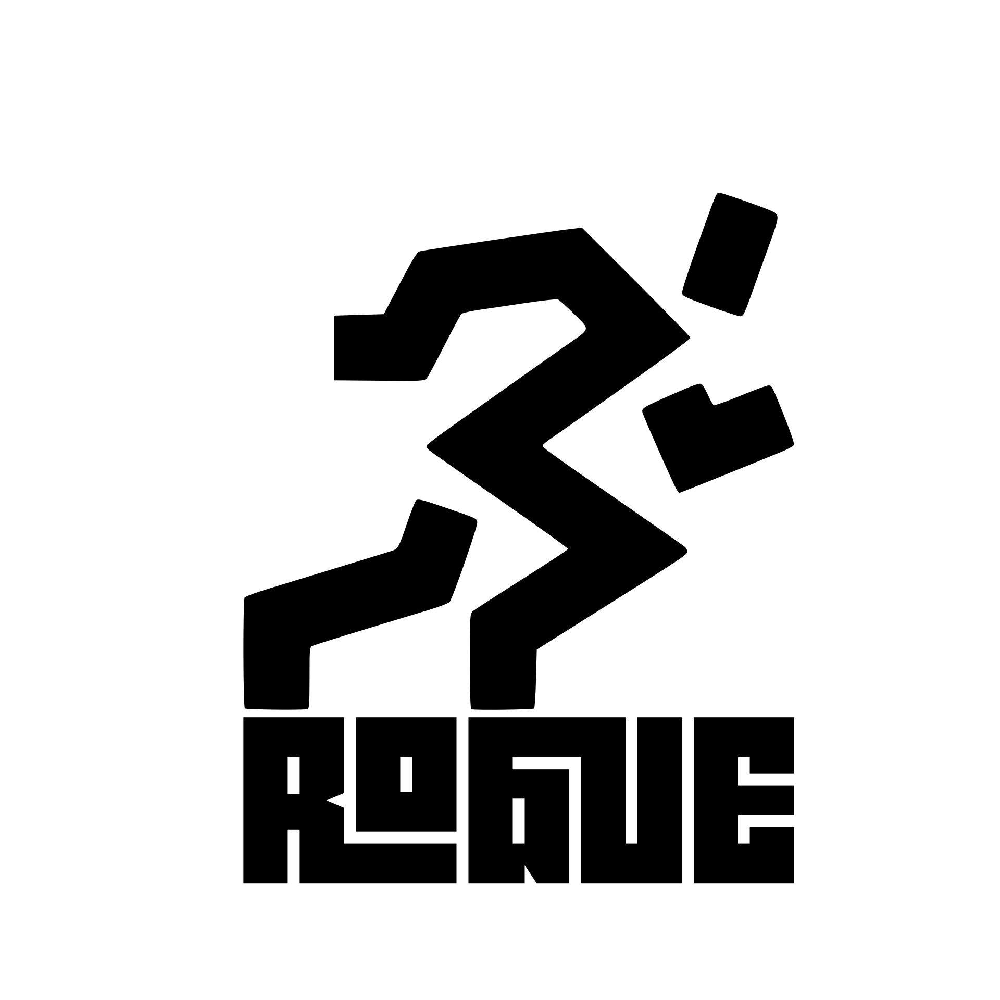
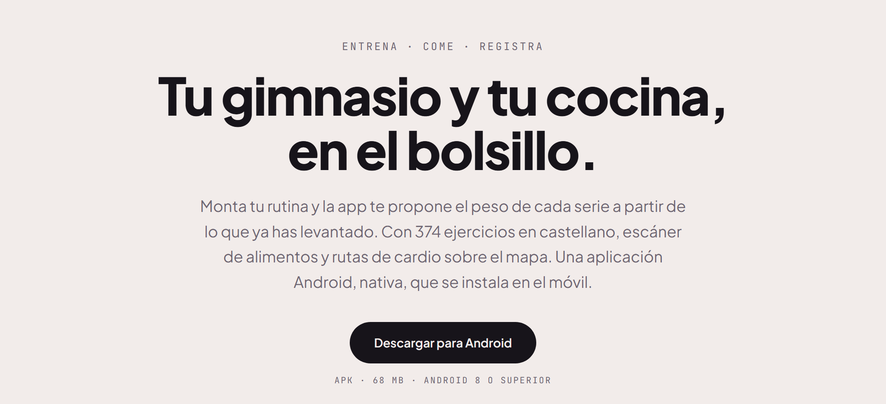
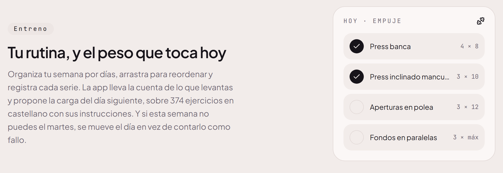
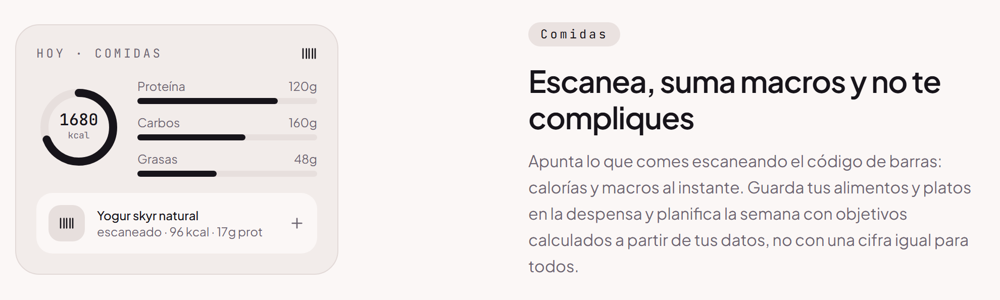
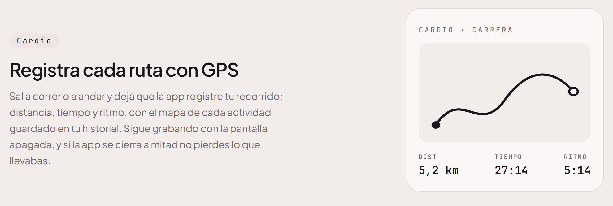

  <picture>
    <source media="(prefers-color-scheme: dark)" srcset="public/brand/logo-full-white.png">
    
  </picture>

  Entrenos, comidas y cardio en una sola app. 
  Te dice cuánto peso poner en cada serie.

  <a href="https://rogue-two.vercel.app/downloads/Rogue.apk"><b>Descargar para Android</b></a>
  &nbsp;·&nbsp;
  <a href="https://rogue-two.vercel.app">Web</a>

  Gratis · Android 8 o superior · 68 MB

<!--
  CAPTURAS DE LA APP
  Van en docs/readme/capturas/ como PNG verticales del móvil, y se pintan aquí
  en una fila de tres o cuatro, a 220 px de ancho:

  

    
    
    
    
  

-->

## Entreno

- **Te propone el peso de cada serie.** Sube cuando cumples el objetivo, lo mantiene cuando te quedas cerca y lo baja si llevas varios intentos sin llegar. Siempre lo puedes cambiar a mano.
- **Tu semana, organizada por días.** La montas tú o la genera la app. Si un día no puedes, se mueve en vez de contar como fallo.
- **374 ejercicios en castellano**, con sus instrucciones. Y puedes crear los tuyos.
- **Recuperación muscular.** Sabes qué músculos están listos para entrenar hoy y cuánto les falta a los demás.

## Comidas

- **Escáner de código de barras.** Calorías y macros al instante, con los datos de Open Food Facts.
- **Despensa.** Guarda tus alimentos y tus platos para apuntarlos con un toque.
- **Objetivos a tu medida.** Calorías y proteína calculadas con tu peso, tu altura y lo que entrenas, no una cifra igual para todos.

## Cardio

- **Rutas con GPS.** Distancia, tiempo y ritmo, con el mapa de cada actividad en tu historial.
- **Con la pantalla apagada.** Sigue grabando con el móvil en el bolsillo, y si la app se cierra a mitad no pierdes lo que llevabas.

## NOA, el asistente

Le preguntas con tus palabras y te responde con tus datos reales:

> ¿Qué me toca hoy?
>
> ¿Tengo la espalda recuperada?
>
> Apúntame un yogur y dos huevos en el desayuno.
>
> Avísame mañana a las 8 de tomar proteína.

Consulta tu historial, planifica tu semana, apunta comidas y entrenos y programa avisos en el móvil. **Antes de cambiar nada, te lo enseña y espera a que digas que sí.**

NOA funciona con una clave gratuita de Google que pones tú en los ajustes de la app. Dentro hay una guía para conseguirla en un minuto. La clave es tuya y solo se usa para tus consultas.

## Instalarla

1. **Descarga el APK** desde [rogue-two.vercel.app](https://rogue-two.vercel.app).
2. **Ábrelo.** Android te pedirá permiso para instalar desde el navegador: acéptalo. Es normal al instalar fuera de Google Play y solo se pide una vez.
3. **Crea tu cuenta** desde la propia app. Te pide tus datos básicos para ajustar los objetivos.

## Preguntas frecuentes

**¿Hay versión para iPhone?**
Todavía no. Publicar en la App Store exige un Mac y una cuenta de desarrollador de pago, así que llegará más adelante.

**¿Por qué no está en Google Play?**
Se instala descargando el archivo directamente. Android avisará de que viene de fuera de la tienda; solo hay que dar permiso una vez.

**¿Es gratis?**
Sí. La cuenta, los entrenos, las comidas y el cardio no cuestan nada. NOA usa tu propia clave de Google, que también es gratuita dentro de su cuota.

---

¿Vienes por el código? La documentación técnica de este repositorio (la landing y la API de NOA) está en [docs/DESARROLLO.md](docs/DESARROLLO.md).
